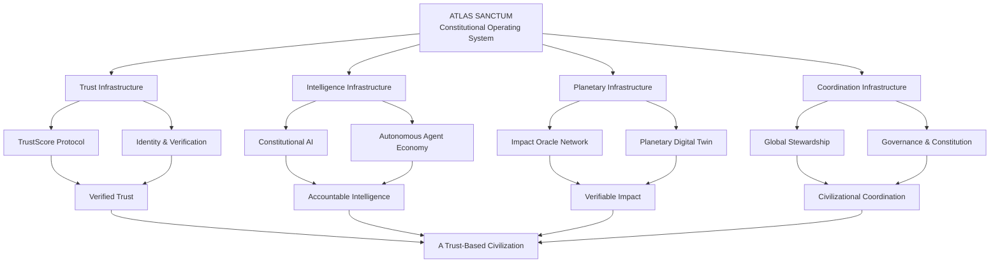
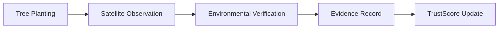
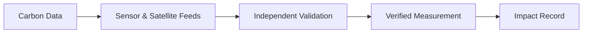
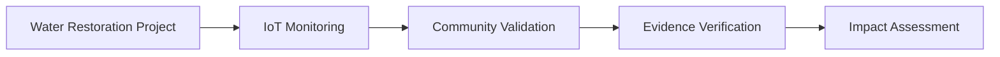
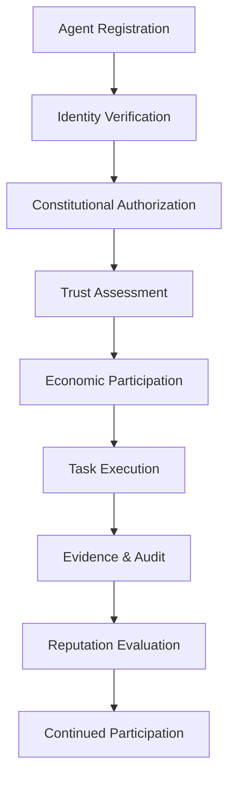

# 🏛️ ATLAS SANCTUM
### The Constitutional Operating System for Civilization

  <strong>TRUST INFRASTRUCTURE FOR CIVILIZATION</strong>
   
  <em>Verifying what matters. Coordinating what scales. Restoring trust to the world's most important systems.</em>

  <a href="#-vision">Vision</a> •
  <a href="#-architecture">Architecture</a> •
  <a href="#-core-systems">Core Systems</a> •
  <a href="#-atlas-constitution">Constitution</a> •
  <a href="#-roadmap">Roadmap</a>

---

## 🌍 01. The Vision

Civilization is entering a new technological era.

Artificial intelligence is becoming autonomous. Economies are becoming increasingly interconnected. Environmental systems are under unprecedented pressure. Governments, organizations, communities, and intelligent machines are generating more data than ever before.

Yet one foundational problem remains:

**We do not have a universal infrastructure for establishing, verifying, coordinating, and sustaining trust.**

Atlas Sanctum is a vision for the next institutional layer of civilization.

A constitutional operating system connecting human institutions, artificial intelligence, planetary intelligence, economic systems, and real-world impact through verifiable trust infrastructure.

We envision a world where:

- Trust is measurable, contextual, and continuously verifiable.
- AI systems operate within transparent constitutional boundaries.
- Real-world impact is supported by verifiable evidence.
- Organizations and governments establish accountable digital identities.
- Autonomous agents participate in governed economic systems.
- Planetary ecosystems become observable and understandable.
- Global coordination becomes more transparent, intelligent, and accountable.

**Our mission is to make trust programmable, impact measurable, and intelligence accountable.**

---

## ✨ 02. The Philosophy

Atlas Sanctum is built around six foundational principles.

| Principle | Meaning |
|---|---|
| Trust | Relationships and claims should be supported by evidence. |
| Accountability | Every participant should be accountable for their actions. |
| Stewardship | Technology should support planetary and human flourishing. |
| Transparency | Decisions and verification processes should be inspectable. |
| Intelligence | AI should augment responsible human coordination. |
| Coordination | Institutions and communities should be able to collaborate across boundaries. |

The objective is not to centralize civilization under one authority.

It is to create interoperable infrastructure through which independent participants can establish trust, exchange verified information, and coordinate responsibly.

---

## 🎨 03. Design Philosophy

The Atlas Sanctum interface should feel like entering humanity's next institutional layer.

Its visual language combines five design disciplines:

- **NASA Mission Control:** operational clarity, planetary visualization, precision instrumentation.
- **Palantir Foundry:** complex intelligence systems, interconnected data, institutional interfaces.
- **Apple Design:** refined typography, minimalism, spatial elegance, and intuitive interaction.
- **Ancient Sacred Geometry:** mathematical harmony, constitutional symbolism, and timeless architecture.
- **Cybernetic Infrastructure:** living networks, autonomous systems, feedback loops, and planetary intelligence.

### Visual Identity

| Element | Specification |
|---|---|
| Deep Obsidian | `#0A0F14` |
| Atlas Emerald | `#00C37A` |
| Sanctum Gold | `#E8C547` |
| Aurora Blue | `#4FD1FF` |
| Data Highlights | `#FFFFFF` |

### Atmospheric Direction

The interface should communicate:

**Awe. Trust. Scale. Destiny. Precision.**

It should not resemble a conventional SaaS dashboard or cryptocurrency landing page.

It should feel like a living mission-control environment for planetary stewardship.

---

## 🛰️ 04. System Architecture

Atlas Sanctum is conceptually organized into interconnected institutional layers.

---

# 🧬 05. Core Systems

## I. TrustScore Protocol
### A Living Reputation Engine

TrustScore is the proposed reputation infrastructure of Atlas Sanctum.

It establishes a framework for evaluating the reliability, accountability, and contribution history of entities participating in the ecosystem.

Participants may include:

- Individuals.
- AI agents.
- Organizations.
- Ecosystems.
- Governments.
- Community institutions.

Every meaningful action can generate evidence.

Every verified claim can contribute to a reputation history.

Every participant can develop a more accountable record of engagement.

**Core philosophy:**

> Every action leaves evidence.  
> Every claim earns verification.  
> Every participant builds trust.

### Conceptual Capabilities

- Verifiable reputation records.
- Contextual trust assessments.
- Evidence-based claim verification.
- Contribution histories.
- Reputation provenance.
- Sybil and manipulation resistance.
- Privacy-preserving verification.
- Interoperable trust credentials.

TrustScore should not become a simplistic universal ranking of human worth. It should express contextual reliability, with transparent criteria, explainability, correction mechanisms, and protection against discriminatory scoring.

---

## II. Constitutional AI
### Intelligence Within Accountable Boundaries

Autonomous intelligence is becoming an increasingly important component of civilization's infrastructure.

But intelligence without accountability becomes risk.

Constitutional AI provides the governance framework through which autonomous systems interact with the Atlas ecosystem.

AI agents should operate within clearly defined constitutional boundaries, permissions, responsibilities, and verification requirements.

### Core Capabilities

- Constitutional policy enforcement.
- Agent identity and authorization.
- Permission-based execution.
- Action traceability.
- Governance checkpoints.
- Human oversight.
- Risk assessment.
- Auditability and accountability.

### Operating Philosophy

> Intelligence without accountability becomes risk.

Atlas Sanctum aims to ensure autonomous systems operate within transparent constitutional boundaries rather than relying solely on opaque behavioral promises.

---

## III. Impact Oracle Network
### Reality Becomes Verifiable

The Impact Oracle Network bridges digital systems and the physical world.

It connects real-world observations with verification mechanisms, allowing environmental and social impact claims to be supported by evidence.

### Potential Data Sources

- Earth observation satellites.
- Remote sensing infrastructure.
- Internet of Things sensors.
- Environmental monitoring stations.
- Community validators.
- Institutional reporting systems.
- Scientific research datasets.

### Example Impact Workflows

**Reforestation**

**Carbon Monitoring**

**Water Restoration**

The ambition is to build an infrastructure where environmental and social claims are increasingly supported by independently verifiable evidence.

---

## IV. Planetary Digital Twin
### Simulate Civilization Before You Change It

The Planetary Digital Twin is the centerpiece of the Atlas Sanctum experience.

A dynamic, interactive representation of interconnected planetary systems.

It brings together geospatial intelligence, environmental observations, economic indicators, infrastructure data, and verified stewardship activity.

### Visualization Layers

| Layer | Representation |
|---|---|
| Ecosystems | Forests, biodiversity, oceans, watersheds |
| Economies | Economic activity and resource flows |
| Cities | Urban development and infrastructure |
| AI Agents | Autonomous systems and their activities |
| Trust Flows | Verified relationships and information pathways |
| Stewardship | Environmental and social impact |

### Interactive Global Intelligence

Users should be able to explore geographic locations and inspect available stewardship information.

Initial demonstration locations:

- Nairobi, Kenya.
- Singapore.
- São Paulo, Brazil.
- New York, United States.

Each location may reveal relevant metrics, including:

- Environmental conditions.
- Ecosystem health.
- Stewardship projects.
- Verified impact events.
- Institutional participation.
- Active AI agents.
- Trust activity.

### Long-Term Vision

Move beyond static dashboards toward a continuously evolving planetary intelligence environment capable of supporting simulation, scenario analysis, and evidence-informed decision-making.

---

## V. Autonomous Agent Economy
### The Economy of Autonomous Intelligence

Atlas Sanctum explores an economy in which AI agents can participate in structured, accountable digital environments.

Agents may:

- Discover opportunities.
- Negotiate tasks.
- Collaborate with other agents.
- Perform authorized services.
- Verify information.
- Contribute research.
- Exchange services.
- Build contextual reputation.

### Agent Lifecycle

**Foundational principle:**

> Agents should earn trust before earning influence.

Influence, permissions, and economic privileges should be proportionate to demonstrated reliability, authorized scope, and accountable behavior.

---

## VI. Atlas Constitution
### The Constitutional Core

The Atlas Constitution represents the normative foundation of the entire ecosystem.

It establishes the rights, responsibilities, governance principles, and operational rules guiding participants.

Inspired by constitutional systems, institutional governance, cybernetics, and systems engineering, it defines the boundaries within which the ecosystem operates.

### Constitutional Pillars

**Article I — Human Dignity**

Human rights, agency, autonomy, and fundamental freedoms must remain central.

**Article II — Transparency**

Verification procedures, governance decisions, and institutional processes should be inspectable.

**Article III — Accountability**

Actions must have traceable responsibility and appropriate mechanisms for redress.

**Article IV — Responsible Intelligence**

Autonomous systems must operate within authorized boundaries and appropriate oversight.

**Article V — Evidence Integrity**

Claims require appropriate supporting evidence and transparent verification standards.

**Article VI — Privacy and Sovereignty**

Personal data, institutional autonomy, and legitimate data rights must be protected.

**Article VII — Planetary Stewardship**

Technology and economic activity should account for ecological sustainability and intergenerational responsibility.

**Article VIII — Fair Coordination**

Governance must provide meaningful participation, procedural fairness, and safeguards against concentrated power.

**Article IX — Due Process**

Reputation decisions, sanctions, and disputed verification outcomes must have correction and appeal mechanisms.

**Article X — Interoperability**

The ecosystem should support open standards and cooperation among independent institutions.

---

# 🌐 06. Global Stewardship Dashboard

### Humanity's Mission Control

The Global Stewardship Dashboard is the operational interface for observing the Atlas Sanctum ecosystem.

A mission-control environment designed around live intelligence, verified data, and interconnected institutional activity.

### Core Metrics

| Metric | Purpose |
|---|---|
| Forests Restored | Verified restoration activity |
| Carbon Verified | Evidence-backed carbon measurements |
| Communities Funded | Tracked community support |
| TrustScore Transactions | Trust-related protocol activity |
| Active AI Agents | Authorized participating agents |
| Sovereign Partners | Participating institutional partners |

*These are proposed dashboard metrics, not current verified platform statistics.*

### Dashboard Experience

- Live global activity visualization.
- TrustScore analytics.
- Environmental intelligence.
- Institutional participation.
- AI agent monitoring.
- Impact verification history.
- Global stewardship mapping.
- Governance activity.

The dashboard should feel like observing civilization's heartbeat through a unified intelligence interface.

---

# 🔭 07. Website Experience & Information Architecture

Atlas Sanctum's website is designed as an immersive journey from the global trust problem toward a new institutional architecture.

### 01 — Planetary Hero

A full-screen animated planetary digital twin.

Earth rotates slowly against a deep obsidian environment. Thousands of interconnected green pathways illuminate forests, cities, oceans, governments, communities, and AI agents.

**Headline:**

# Atlas Sanctum

### Trust Infrastructure for Civilization

"Verifying what matters. Coordinating what scales. Restoring trust to the world's most important systems."

Primary CTA: **Begin Stewardship**

Secondary CTA: **Explore the Network**

Cursor movement illuminates trust pathways across the globe.

### 02 — Living Trust Layer

A monumental visualization of interconnected trust nodes.

Nodes represent people, AI agents, organizations, ecosystems, and governments.

Data streams continuously move between these entities.

**Central statement:**

# Trust Is The New Infrastructure

The animation communicates the progression:

Claims → Verification → Reputation → Coordination → Impact → Civilization.

### 03 — The Problem

An immersive dark environment showing fragmented information systems, broken connections, and institutional failures.

**Headline:**

# Civilization Has A Trust Problem

" The world has systems for moving money. The world lacks systems for moving trust."

Visual themes:

- Fraud.
- Corruption.
- Misinformation.
- Unverifiable AI.
- Unsubstantiated ESG claims.
- Disconnected institutions.

Any displayed statistics must be backed by credible sources.

### 04 — The Atlas Solution

The fractured networks begin reconnecting.

Three monumental institutional pillars emerge:

- TrustScore.
- Constitutional AI.
- Impact Oracle Network.

**Headline:**

# The Trust Clearing House of Civilization

### 05 — Planetary Digital Twin

The centerpiece of the website.

A cinematic, interactive globe representing ecosystems, economies, cities, AI agents, and trust flows.

**Headline:**

# Simulate Civilization Before You Change It

### 06 — Autonomous Agent Economy

An animated environment showing AI agents negotiating, collaborating, verifying, and participating in governed economic activities.

**Headline:**

# The Economy of Autonomous Intelligence

"Where agents earn reputation before they earn influence."

### 07 — Atlas Constitution

A sacred geometric vault representing the constitutional core.

Articles illuminate as users navigate through the constitutional principles.

**Headline:**

# Code Is Powerful. Constitutions Are Stronger.

### 08 — Global Stewardship

A mission-control dashboard showcasing planetary intelligence and measurable stewardship activity.

### 09 — The Vision

A cinematic transition from Earth into an interconnected living network.

Statements emerge:

**We Believe Trust Should Be Verifiable.**

**Impact Should Be Measurable.**

**Intelligence Should Be Accountable.**

**Civilization Should Be Coordinated.**

Final declaration:

# Atlas Sanctum

### The Constitutional Operating System for Planetary Stewardship

---

# ⚙️ 08. Technical Architecture & Engineering Direction

Atlas Sanctum is intended to evolve into a modular, interoperable infrastructure connecting identity, verification, intelligence, governance, and planetary data systems.

### Conceptual Technology Layers

| Layer | Responsibilities |
|---|---|
| Experience Layer | Immersive web interface and mission control |
| Identity Layer | Human, institutional, and agent identities |
| Trust Layer | Reputation, credentials, and verification |
| Intelligence Layer | Constitutional AI and autonomous agents |
| Impact Layer | Oracles, environmental observations, and evidence |
| Simulation Layer | Planetary digital twin and scenario modeling |
| Governance Layer | Constitution, policies, participation, and oversight |
| Infrastructure Layer | APIs, data pipelines, storage, and integrations |

### Engineering Priorities

1. Modular, independently maintainable services.
2. Open and interoperable data standards.
3. Cryptographic verification and evidence provenance.
4. Secure AI agent authorization.
5. Privacy-preserving identity and credentials.
6. Reliable real-world data ingestion.
7. Explainable reputation mechanisms.
8. Resilient and auditable governance infrastructure.

Specific implementation technologies should be selected according to the requirements of each subsystem rather than forcing every component into a single technology stack.

---

# 🗺️ 09. Development Roadmap

Atlas Sanctum will evolve through progressive infrastructure development.

### Phase I — Institutional Experience

- [ ] Develop the immersive planetary landing experience.
- [ ] Build the living trust network visualization.
- [ ] Establish the Atlas visual identity.
- [ ] Create the website's institutional information architecture.
- [ ] Develop the Global Stewardship Dashboard prototype.

### Phase II — Trust Infrastructure

- [ ] Establish decentralized identity architecture.
- [ ] Develop TrustScore methodology.
- [ ] Implement evidence and verification records.
- [ ] Introduce contextual reputation credentials.
- [ ] Develop privacy and dispute-resolution safeguards.

### Phase III — Constitutional Intelligence

- [ ] Formalize the Atlas Constitution.
- [ ] Design constitutional policy enforcement.
- [ ] Develop AI agent identity and authorization.
- [ ] Introduce agent action traceability.
- [ ] Implement human oversight mechanisms.

### Phase IV — Impact Oracle Network

- [ ] Integrate environmental data sources.
- [ ] Develop satellite observation pipelines.
- [ ] Integrate IoT and sensor networks.
- [ ] Establish independent validation workflows.
- [ ] Connect verified evidence to impact records.

### Phase V — Planetary Digital Twin

- [ ] Develop interactive geospatial visualization.
- [ ] Integrate ecosystem intelligence.
- [ ] Introduce urban and environmental datasets.
- [ ] Develop scenario simulation capabilities.
- [ ] Support regional stewardship intelligence.

### Phase VI — Autonomous Agent Economy

- [ ] Develop governed agent participation.
- [ ] Introduce agent-to-agent collaboration.
- [ ] Establish task verification.
- [ ] Develop contextual agent reputation.
- [ ] Explore programmable economic coordination.

### Phase VII — Global Institutional Ecosystem

- [ ] Establish governance participation.
- [ ] Build institutional partnerships.
- [ ] Develop interoperability standards.
- [ ] Expand global stewardship integrations.
- [ ] Support cross-institutional trust coordination.

*Roadmap items represent intended development directions and are not claims of existing production functionality.*

---

# 🤝 10. Ecosystem & Collaboration

Atlas Sanctum is conceived as an open institutional architecture that can bring together:

- AI researchers and developers.
- Cybersecurity and cryptography researchers.
- Environmental scientists.
- Governments and public institutions.
- Universities and research laboratories.
- Civil society organizations.
- Blockchain and decentralized infrastructure developers.
- Sustainability innovators.
- Independent contributors.

Potential collaboration areas include trust protocols, constitutional AI, digital identity, satellite intelligence, environmental verification, privacy engineering, governance, and planetary simulation.

---

# 🔐 11. Security, Ethics & Institutional Integrity

Civilization-scale infrastructure requires civilization-scale responsibility.

Atlas Sanctum's development principles include:

- Security by design.
- Data minimization.
- Privacy preservation.
- Cryptographic integrity.
- Independent verification.
- Transparent governance.
- Human oversight.
- Fairness and accountability.
- Explainable reputation systems.
- Protection against manipulation and institutional capture.

Trust must never become an excuse for surveillance, coercion, or centralized control.

A trustworthy institution must also be accountable for its own decisions.

---

# 📚 12. Research & Knowledge Domains

The Atlas Sanctum research vision intersects several disciplines:

| Domain | Research Direction |
|---|---|
| Cybernetics | Coordination and feedback systems |
| Distributed Systems | Interoperable institutional infrastructure |
| Artificial Intelligence | Constitutional and accountable intelligence |
| Cryptography | Verifiable trust and digital credentials |
| Game Theory | Incentive alignment and cooperation |
| Systems Engineering | Complex infrastructure orchestration |
| Earth Observation | Planetary intelligence |
| Environmental Science | Evidence-based stewardship |
| Governance | Institutional legitimacy and accountability |
| Digital Twins | Simulation of complex interconnected systems |

---

# 🌌 13. The Future We Are Building

We believe trust should be verifiable.

Impact should be measurable.

Intelligence should be accountable.

Civilization should be coordinated.

We believe humanity needs more than faster technology.

It needs better institutions, better coordination mechanisms, and infrastructure worthy of its collective future.

Atlas Sanctum is an attempt to build toward that future.

Not another dashboard.

Not another blockchain application.

Not another artificial intelligence platform.

**A constitutional infrastructure for a world in which humans, institutions, intelligent machines, and planetary systems can coordinate with greater transparency and responsibility.**

---

# 🏛️ ATLAS SANCTUM

## The Constitutional Operating System for Planetary Stewardship.

**Civilizations rise on trust. Atlas Sanctum exists to make trust programmable.**

---

## 🔗 Explore the Ecosystem

| Resource | Description |
|---|---|
| Constitution | Institutional principles and governance framework |
| TrustScore Protocol | Reputation and verification infrastructure |
| Impact Oracle Network | Real-world evidence and impact verification |
| Planetary Digital Twin | Global intelligence and simulation |
| Research | Scientific and technical foundations |
| Ecosystem | Institutional and community partnerships |
| Governance | Accountability and decision-making |
| Developers | Technical documentation and integrations |

---

  <strong>ATLAS SANCTUM</strong>
   
  <em>TRUST IS THE FOUNDATION. STEWARDSHIP IS THE PURPOSE. CIVILIZATION IS THE MISSION.</em>
    
  🌍 Built for Humanity. Designed for the Future.

